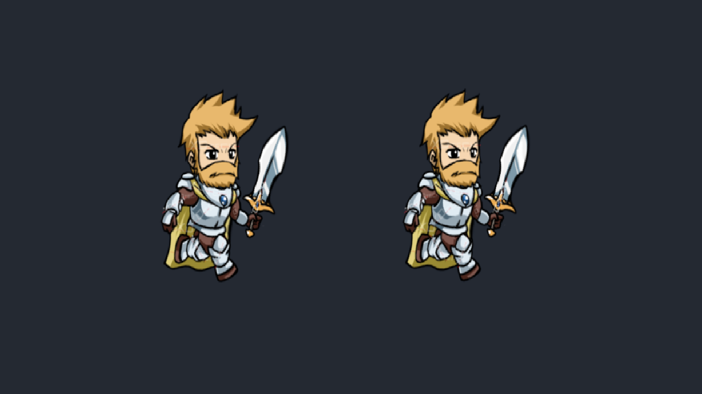

# Spine38-Unity6

Spine 3.8 在 **Unity 6.3（6000.3）** 中的非官方兼容性适配与验证工程。

基于 `spine-unity-3.8-2021-11-10.unitypackage`，保留 Spine 3.8 骨骼、动画数据格式和运行时接口，支持原始 **3.8.75 JSON 与二进制导出数据**。已在 **Unity 6000.3.27f2** 下验证 Built-in、URP 3D 和 URP 2D 的相关用例。

## 下载

在 [Releases](https://github.com/DaNiuNai/Spine38-Unity6/releases) 的 **Assets** 区域下载安装包，或使用下面的直接链接：

| 安装包 | 用途 | 下载 |
|---|---|---|
| `spine-unity-3.8-unity6000.3.unitypackage` | 必装：核心运行时、编辑器工具与原有示例 | [下载核心 SDK](https://github.com/DaNiuNai/Spine38-Unity6/releases/latest/download/spine-unity-3.8-unity6000.3.unitypackage) |
| `com.esotericsoftware.spine.urp-shaders-3.8.2.tgz` | 可选：URP Shader 扩展 | [下载 URP 扩展](https://github.com/DaNiuNai/Spine38-Unity6/releases/latest/download/com.esotericsoftware.spine.urp-shaders-3.8.2.tgz) |
| `com.esotericsoftware.spine.timeline-3.8.4.tgz` | 可选：Timeline 集成 | [下载 Timeline 扩展](https://github.com/DaNiuNai/Spine38-Unity6/releases/latest/download/com.esotericsoftware.spine.timeline-3.8.4.tgz) |

本仓库的 Release 版本号用于标识兼容适配版本；Spine 运行时仍为 3.8，两个扩展保留其上游包版本号。安装包的 SHA-256 见对应 Release 说明。

## 导入到自己的项目

### 1. 准备项目依赖

下面的步骤面向 Unity 6000.3。已验证的包版本为：

| 依赖 | 验证版本 | 何时需要 |
|---|---|---|
| Unity UI / uGUI（`com.unity.ugui`） | 2.0.0 | 核心 SDK |
| Universal RP（`com.unity.render-pipelines.universal`） | 17.3.0 | URP 项目 |
| Timeline（`com.unity.timeline`） | 1.8.13 | 使用 Timeline 扩展 |
| Input System（`com.unity.inputsystem`） | 1.20.1 | 使用新输入系统的示例 |

先通过 Package Manager 安装需要的 Unity 官方包，再安装 Spine 扩展；保留目标项目中适配 Unity 6000.3 的 URP / Timeline 版本。核心动画运行时不依赖新 Input System，示例适配层通过条件编译按需启用。

已有 Spine 的项目请先建立版本控制检查点，核对原有版本及自定义修改，再按原安装方式更新；同一项目保留一套 Spine 运行时。

### 2. 导入核心 SDK

1. 打开目标 Unity 项目。
2. 选择 **Assets → Import Package → Custom Package**。
3. 选择 `spine-unity-3.8-unity6000.3.unitypackage`。
4. 保留完整的 `Assets/Spine`；需要示例时同时导入 `Assets/Spine Examples`。
5. 点击 **Import**，等待导入和编译完成。

### 3. 按需安装扩展

将需要的 `.tgz` 放在目标项目内的固定目录，例如：

```text
YourProject/
├─ Assets/
├─ Packages/
└─ LocalPackages/
   └─ Spine/
      ├─ com.esotericsoftware.spine.urp-shaders-3.8.2.tgz
      └─ com.esotericsoftware.spine.timeline-3.8.4.tgz
```

在 **Package Manager → ＋ → Install package from tarball** 中选择对应文件。Built-in 项目只需核心 SDK；URP 项目增加 URP 扩展；需要 Timeline 时再增加 Timeline 扩展。

团队同步时，将导入的代码和资源、对应 `.meta`、Unity 更新的 `Packages/manifest.json` / `packages-lock.json`，以及项目内的 `.tgz` 一起提交到版本控制。

### 4. 配置 Shader 与纹理

| 使用场景 | 基础 Shader |
|---|---|
| Built-in 世界物体 | `Spine/Skeleton` |
| URP 3D Renderer 世界物体 | `Universal Render Pipeline/Spine/Skeleton` |
| URP 2D Renderer 世界物体 | `Universal Render Pipeline/2D/Spine/Skeleton` |
| Canvas 中的 SkeletonGraphic | `Spine/SkeletonGraphic` |

需要光照时选用相应管线的 Lit / Sprite Shader。SkeletonGraphic 继续使用其专用 UI Shader。

**Linear 颜色空间使用 Straight Alpha 工作流：**

- Spine 导出图集时关闭 **Premultiply alpha**，开启 **Bleed**。
- Unity 的 Spine 偏好设置中使用 `StraightAlphaPreset` 导入预设。
- Spine 材质启用 **Straight Alpha Texture**。

原版示例中的 PMA 图集适合 Gamma 工作流。在 Linear 项目中直接使用这些示例材质，会出现工作流提示；各次构建的实际警告保留在验证摘要中。

### 5. 导入角色

通常选择一种骨骼数据格式，将配套文件放在同一目录：

```text
hero.json 或 hero.skel.bytes
hero.atlas.txt
hero.png（多页图集需包含全部 PNG）
```

等待 Unity 生成 SkeletonData / Atlas 资源后，使用 `SkeletonAnimation` 或 `SkeletonGraphic` 播放。若要对照 JSON 和二进制，请分开放在两个目录，避免同名生成资源相互覆盖。

示例的新输入系统适配自动作用于原 SDK 示例目录和 URP 扩展示例目录。将示例复制到自己的场景目录后，请按游戏输入方案配置 `EventSystem`、`InputSystemUIInputModule` 和需要的 `PhysicsRaycaster`。

## 主要改动

- 读取原始 3.8.75 JSON / 二进制版本头，继续由 3.8 读取器校验数据结构。
- 更新 Unity 6 的 2D 刚体 API，延迟在安全的编辑器更新阶段创建 Spine 偏好资源。
- 兼容示例的新旧输入系统，补充键盘、手柄、UI、点击、拖拽和布娃娃交互。
- URP 扩展移植后续官方 Shader 修复，适配 URP 17 的 2D 光照及 Forward+ 光照宏。
- 保留 Timeline 集成，并验证编辑器预览、Inspector、Mecanim Clip 和 Prefab 烘焙流程。

URP Shader 来源及移植说明见 [UPSTREAM-NOTICE.txt](SpineExtensions/com.esotericsoftware.spine.urp-shaders/UPSTREAM-NOTICE.txt)。Shader 移植没有将骨骼／动画运行时升级到 Spine 4.x。

## 验证范围

验证环境：**Unity 6000.3.27f2、URP 17.3.0**。以下是已执行的检查，不代表所有 Unity 小版本、设备和自定义资源组合均经过验证。

| 目标 | 构建结果 | 运行检查 |
|---|---|---|
| Windows / Built-in | 通过，零错误、零警告 | 已人工确认 JSON 与二进制角色正常跑步 |
| Windows / URP | 通过，零错误 | 编辑器场景与渲染检查通过 |
| Android / IL2CPP / URP | APK 构建通过，零错误 | 已人工确认两个角色正常跑步；设备型号未记录 |
| WebGL / URP | 构建通过，零错误 | 已人工确认浏览器中两个角色正常跑步 |
| iOS / URP | Xcode 工程导出通过，零错误 | **尚未在 Mac/Xcode 和 iOS 设备上完成编译、签名及运行验证** |

自动检查包括：

- 真实 Spine **3.8.75** 素材：8 段动画、960 帧的 JSON / 二进制骨骼与网格对照。
- 21 个骨骼、102 段动画、59 个皮肤、2,550 次网格生成，覆盖法线、切线和双色着色通道。
- 31 个 Built-in 示例、33 个 URP 场景，以及 URP 2D 示例。
- 动画事件、混合、完成回调、Timeline 预览／运行时绑定及输入交互检查。
- 89 个资源 Inspector 初始化、8 个 Mecanim Clip、8 个烘焙动画 Clip 和 1 个 Prefab 的生成检查。



详细证据：[验证摘要](Artifacts/SpineCompatibility/validation-summary.json) · [真实素材对照](Artifacts/SpineCompatibility/real-3.8.75.json) · [人工运行反馈](Artifacts/SpineCompatibility/manual-validation.json) · [兼容说明](Assets/Spine/UNITY6000-COMPATIBILITY.txt)

## 仓库结构与复现

| 路径 | 内容 |
|---|---|
| `Assets/Spine` | 适配后的核心运行时和编辑器工具 |
| `Assets/Spine Examples` | 原示例及可选 Input System 适配层 |
| `SpineExtensions` | 本地 URP / Timeline UPM 包源码 |
| `Assets/SpineCompatibility` | 真实导出素材与验证场景 |
| `Assets/Editor/SpineCompatibility` | 编辑器验证与项目构建辅助代码 |
| `AgentScripts` | 回归、构建检查、导出与预览工具 |
| `Artifacts/SpineCompatibility` | 精简验证记录和截图 |

验证工具的运行方式见 [AgentScripts/README.txt](AgentScripts/README.txt)。安装包由 Unity 导出；完整构建日志、Player 二进制和安装包输出不纳入 Git，发布用安装包保存在 Releases 中。

## 上游与授权

本仓库包含 Esoteric Software 的 Spine Runtimes 代码及相关 Shader。原版权声明和授权文本随源码／安装包保留，使用与分发请遵守相应原授权协议。

- 核心运行时授权文本：[源码文件头](Assets/Spine/Runtime/spine-csharp/SkeletonJson.cs)
- [URP 扩展原授权](SpineExtensions/com.esotericsoftware.spine.urp-shaders/LICENSE.md)
- [移植 Shader 的授权文本](SpineExtensions/com.esotericsoftware.spine.urp-shaders/UPSTREAM-SHADERS-LICENSE.txt)
- [Timeline 扩展授权](SpineExtensions/com.esotericsoftware.spine.timeline/LICENSE.md)
- [上游 Spine Runtimes](https://github.com/EsotericSoftware/spine-runtimes)
